# 宿舍管理系统小程序--论文pf

> 🎓 **计算机毕业设计 · 宿舍管理系统小程序--论文pf**
>
> 本仓库只放**项目介绍 + 运行截图**（截图是站点带水印的原图，存在仓库 `images/` 里）。
>
> 👉 **完整可运行源码 / 数据库脚本 / 部署文档：[点我获取](https://geekcode.top/archives/%E5%AE%BF%E8%88%8D%E7%AE%A1%E7%90%86%E7%B3%BB%E7%BB%9F%E5%B0%8F%E7%A8%8B%E5%BA%8F-%E8%AE%BA%E6%96%87pf?utm_source=github)**
>
> 💬 咨询微信：**ir9372**　|　🌐 更多项目：[极客代码 geekcode.top](https://geekcode.top/?utm_source=github)
>
> 📌 项目详情页：<https://geekcode.top/archives/%E5%AE%BF%E8%88%8D%E7%AE%A1%E7%90%86%E7%B3%BB%E7%BB%9F%E5%B0%8F%E7%A8%8B%E5%BA%8F-%E8%AE%BA%E6%96%87pf?utm_source=github>

<table><td width="230" align="center"> <b>扫码加微信 ir9372</b></td><td valign="middle">📦 源码 = 项目介绍 + 全部运行截图 + 数据库 + 部署文档 👉 点上方任意截图，直接跳到 <b>极客代码 geekcode.top</b> 详情页</td></table>

---

<h1>宿舍管理系统小程序--论文pf</h1>
<h2>项目概述</h2>

本项目为“宿舍管理系统小程序--论文pf”，旨在构建一套基于微信小程序前端与 Java 后端分离架构的宿舍综合管理平台。系统核心功能涵盖宿舍分配、学生考勤、卫生检查、报修处理、访客管理及公告新闻发布等模块，解决传统宿舍管理中信息滞后、流程繁琐及数据孤岛问题。适用人群包括学校宿管中心管理员、负责宿舍管理的教师以及在校住宿学生。技术架构上，后端采用 Spring Boot 框架结合 MyBatis-Plus 进行数据持久化，使用 Shiro 实现权限控制；前端通过微信小程序提供移动端服务，后台管理端则基于 Thymeleaf 模板引擎构建 Web 界面，实现了多终端协同的高效管理模式。

<h2>技术架构</h2>

本系统采用前后端分离的开发模式，具体架构如下：

<ol>
<li><strong>后端架构</strong>：</li>
</ol>
<ul>
<li><strong>核心框架</strong>：基于 Spring Boot 快速搭建应用骨架，利用其自动配置特性简化开发流程。</li>
<li><strong>数据层</strong>：集成 MyBatis-Plus 作为 ORM 框架，提供通用的 CRUD 操作及分页插件，提升数据库交互效率。数据库选用 MySQL，存储用户、宿舍、报修单、考勤记录等业务数据。</li>
<li><strong>安全与权限</strong>：引入 Apache Shiro 框架进行身份认证与授权管理，确保不同角色（如管理员、普通用户）只能访问其权限范围内的资源。</li>
<li><strong>视图层</strong>：Web 后台管理端使用 Thymeleaf 模板引擎渲染页面，实现服务端动态内容生成。</li>
</ul>
<ol start="2">
<li><strong>前端架构</strong>：</li>
</ol>
<ul>
<li><strong>微信小程序端</strong>：作为主要面向学生和教师的移动入口，通过 HTTP/HTTPS 协议调用后端提供的 RESTful API 接口获取数据并提交表单。小程序端负责展示首页、个人信息、报修列表、宿舍成员、卫生及考勤等数据。</li>
<li><strong>Web 管理端</strong>：面向系统管理员和宿管老师，通过浏览器访问后台路由（如 <code>/users</code>, <code>/baoxiu</code> 等），进行全局配置、用户管理及业务审批操作。</li>
</ul>
<ol start="3">
<li><strong>交互方式</strong>：
   小程序前端与 Java 后端之间完全通过 REST API 进行通信。后端 Controller 层（如 <code>BaoxiuController</code>, <code>SusheController</code>）接收 JSON 格式的请求参数，处理后返回标准化的 JSON 响应数据，实现了业务逻辑与展示层的解耦。</li>
</ol>
<h2>功能模块</h2>

根据代码上下文中的 Controller 列表、后台路由及截图功能，系统主要功能模块划分如下：

<h3>1. 微信小程序用户端</h3>

该端主要服务于学生和管理老师，提供便捷的移动查询与申报功能：

<ul>
<li><strong>基础服务</strong>：包含登录、注册、忘记密码及修改密码功能，用于账户身份验证。</li>
<li><strong>个人中心</strong>：查看与编辑个人基本信息（userinfo）。</li>
<li><strong>信息发布与浏览</strong>：</li>
<li><strong>公告</strong>：查看学校或宿舍发布的最新通知。</li>
<li><strong>新闻信息</strong>：浏览相关新闻资讯。</li>
<li><strong>宿舍业务管理</strong>：</li>
<li><strong>报修列表</strong>：提交宿舍设施维修申请并查看处理进度。</li>
<li><strong>宿舍成员列表</strong>：查看同宿舍成员的详细信息。</li>
<li><strong>宿舍卫生列表</strong>：查看宿舍卫生检查结果或评分。</li>
<li><strong>学生考勤列表</strong>：查看个人的考勤记录状态。</li>
</ul>
<h3>2. Web 后台管理端</h3>

该端主要服务于超级管理员及高层管理人员，提供全系统的配置与监管功能：

<ul>
<li><strong>系统配置与安全</strong>：</li>
<li><strong>配置文件 (<code>/config</code>)</strong>：管理系统全局参数。</li>
<li><strong>备份还原 (<code>/beifen</code>, <code>/huanyuan</code>)</strong>：执行数据库备份与恢复操作，保障数据安全。</li>
<li><strong>字典管理 (<code>/dictionary</code> 及相关子路由)</strong>：维护系统枚举值，包括报修状态、单元、公告类型、禁用状态、楼栋、新闻分类、性别、宿舍卫生标准、学生考勤类型等基础数据字典。</li>
<li><strong>用户与角色管理</strong>：</li>
<li><strong>用户管理 (<code>/users</code>)</strong>：管理系统所有注册用户账号。</li>
<li><strong>管理员管理 (<code>/guanlilaoshi</code>)</strong>：专门管理具有管理权限的老师或工作人员账号。</li>
<li><strong>业务数据管理</strong>：</li>
<li><strong>报修管理 (<code>/baoxiu</code>)</strong>：审核、分配及跟踪学生的报修请求。</li>
<li><strong>访客管理 (<code>/fangke</code>)</strong>：登记与查询外来访客信息。</li>
<li><strong>公告管理 (<code>/gonggao</code>)</strong>：发布、编辑及删除系统公告。</li>
<li><strong>新闻管理 (<code>/news</code>)</strong>：维护新闻资讯内容。</li>
<li><strong>宿舍管理 (<code>/sushe</code>)</strong>：维护宿舍楼宇、房间及床位基础信息。</li>
<li><strong>宿舍学生关联 (<code>/susheXuesheng</code>)</strong>：管理学生与宿舍房间的绑定关系。</li>
<li><strong>宿舍卫生管理 (<code>/susheweisheng</code>)</strong>：录入与管理各宿舍的卫生检查数据。</li>
<li><strong>学生考勤管理 (<code>/xueshengkaoqin</code>)</strong>：记录、统计及导出学生考勤数据。</li>
</ul>
<h2>用户角色与权限</h2>

系统基于 Shiro 框架实现细粒度的权限控制，主要涉及以下角色及其权限范围：

<h3>1. 超级管理员 (Admin)</h3>
<ul>
<li><strong>访问入口</strong>：Web 后台管理端 (<code>/admin</code>)。</li>
<li><strong>权限范围</strong>：拥有系统最高权限。</li>
<li><strong>系统运维</strong>：可访问配置文件、执行数据备份与还原。</li>
<li><strong>基础数据维护</strong>：全面管理各类字典数据（如报修状态、楼栋信息等）。</li>
<li><strong>用户管理</strong>：创建、编辑、禁用普通用户及管理老师账号。</li>
<li><strong>业务全流程管控</strong>：对报修、访客、公告、新闻、宿舍、卫生、考勤等所有业务模块拥有增删改查权限。</li>
</ul>
<h3>2. 管理老师 (Guanlilaoshi)</h3>
<ul>
<li><strong>访问入口</strong>：Web 后台管理端或微信小程序端（视具体配置而定，通常具备部分后台权限或小程序特殊视图）。</li>
<li><strong>权限范围</strong>：</li>
<li><strong>日常监管</strong>：可查看所辖区域的学生考勤、宿舍卫生状况及报修进度。</li>
<li><strong>信息录入</strong>：负责录入卫生检查结果、更新考勤状态或处理特定类型的报修反馈。</li>
<li><strong>受限管理</strong>：通常无法修改系统核心配置、字典定义或进行数据库备份操作，也无法管理其他管理员账号。</li>
</ul>
<h3>3. 学生用户 (Student/User)</h3>
<ul>
<li><strong>访问入口</strong>：微信小程序端。</li>
<li><strong>权限范围</strong>：</li>
<li><strong>自助服务</strong>：仅限查看和操作与自己相关的数据。</li>
<li><strong>信息查询</strong>：查看公告、新闻、宿舍成员名单。</li>
<li><strong>业务发起</strong>：提交报修申请，查看自己的报修状态、卫生评分及考勤记录。</li>
<li><strong>账户管理</strong>：修改个人基本信息及密码。</li>
<li><strong>限制</strong>：无权访问 Web 后台，无权查看他人隐私数据或修改系统基础数据。</li>
</ul>
<h2>项目特色与创新点</h2>
<ol>
<li><strong>多端协同的管理闭环</strong>：项目创新性地结合了微信小程序的便捷性与 Web 后台的强大管理能力。学生通过小程序随时随地提交报修、查看考勤，极大提升了用户体验和响应速度；而管理人员通过 Web 后台进行批量数据处理、字典维护和复杂报表分析，确保了管理的高效性与规范性。</li>
<li><strong>高度可配置的字典驱动机制</strong>：系统设计了丰富的数据字典模块（如 <code>dictionaryBaoxiuZhuangtai</code>, <code>dictionarySusheweisheng</code> 等），将业务规则（如报修状态流转、卫生评分标准、考勤类型）抽象为可配置项。这种设计使得系统在应对不同学校的管理制度变化时，无需修改代码即可通过后台调整业务逻辑，具备良好的扩展性和适应性。</li>
<li><strong>完善的宿舍生态覆盖</strong>：不同于单一的宿舍分配系统，本项目涵盖了从硬件设施（报修）、环境卫生（卫生检查）、人员流动（访客、成员管理）到纪律约束（考勤）的全方位宿舍生活场景，构建了完整的宿舍数字化管理生态。</li>
<li><strong>安全性与稳定性保障</strong>：集成 Shiro 权限框架确保数据隔离，防止越权访问；内置备份与还原功能（<code>/beifen</code>, <code>/huanyuan</code>）为关键业务数据提供了容灾保障，体现了企业级应用的严谨性。</li>
</ol>
<h2>部署环境</h2>

运行本项目所需的软件及硬件环境如下：

<ol>
<li><strong>开发环境与工具</strong>：</li>
</ol>
<ul>
<li><strong>JDK</strong>：建议版本 JDK 1.8 或以上，用于编译和运行 Java 后端程序。</li>
<li><strong>Maven</strong>：用于项目依赖管理和构建打包。</li>
<li><strong>IDE</strong>：IntelliJ IDEA 或 Eclipse，用于后端代码开发。</li>
<li><strong>微信开发者工具</strong>：用于小程序前端的调试、预览及上传发布。</li>
<li><strong>Node.js</strong>：若小程序前端工程基于 Vue 或需要 npm 包管理，需安装 Node.js 环境。</li>
</ul>
<ol start="2">
<li><strong>服务器与数据库</strong>：</li>
</ol>
<ul>
<li><strong>操作系统</strong>：Windows Server, Linux (CentOS/Ubuntu) 或 macOS。</li>
<li><strong>数据库</strong>：MySQL 5.7 或 8.0+，需初始化对应的表结构及基础数据。</li>
<li><strong>Web 容器</strong>：Spring Boot 内置 Tomcat，无需额外安装独立 Web 服务器，但生产环境建议配合 Nginx 进行反向代理和静态资源托管。</li>
</ul>
<ol start="3">
<li><strong>网络要求</strong>：</li>
</ol>
<ul>
<li>服务器需具备公网 IP 或内网穿透能力，以便微信小程序能够访问后端 API 接口。</li>
<li>需在微信公众平台配置合法的域名白名单（request 合法域名），以允许小程序发起 HTTPS 请求。</li>
</ul>
<h2>五、技术特性</h2>
<ul>
<li>前后端集成部署，前端资源打包至后端 static 目录</li>
<li>使用 MyBatis-Plus 简化数据访问层开发</li>
<li>集成 Shiro 权限框架实现角色权限控制</li>
</ul>
<h2>六、功能模块截图</h2>
<h3>微信小程序用户端</h3>

<figure><a href="https://geekcode.top/archives/%E5%AE%BF%E8%88%8D%E7%AE%A1%E7%90%86%E7%B3%BB%E7%BB%9F%E5%B0%8F%E7%A8%8B%E5%BA%8F-%E8%AE%BA%E6%96%87pf?utm_source=github" title="查看完整源码">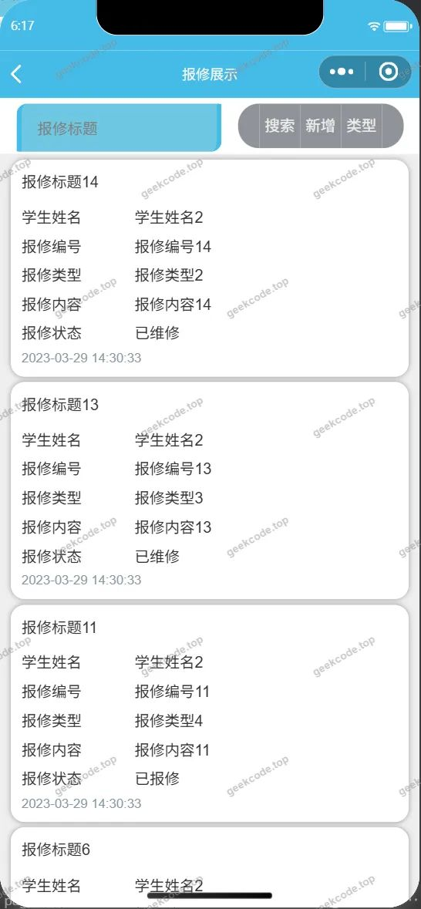</a><figcaption>小程序-报修列表</figcaption></figure>
<figure><a href="https://geekcode.top/archives/%E5%AE%BF%E8%88%8D%E7%AE%A1%E7%90%86%E7%B3%BB%E7%BB%9F%E5%B0%8F%E7%A8%8B%E5%BA%8F-%E8%AE%BA%E6%96%87pf?utm_source=github" title="查看完整源码">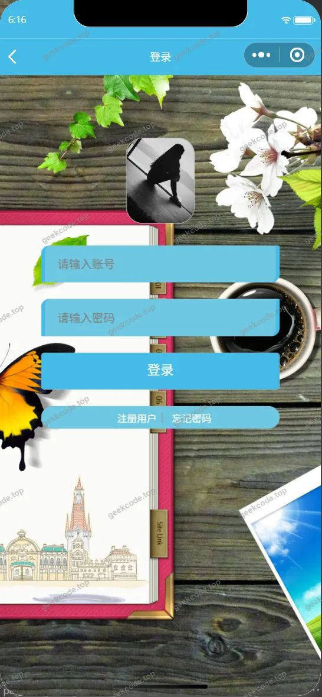</a><figcaption>小程序-登录</figcaption></figure>
<figure><a href="https://geekcode.top/archives/%E5%AE%BF%E8%88%8D%E7%AE%A1%E7%90%86%E7%B3%BB%E7%BB%9F%E5%B0%8F%E7%A8%8B%E5%BA%8F-%E8%AE%BA%E6%96%87pf?utm_source=github" title="查看完整源码">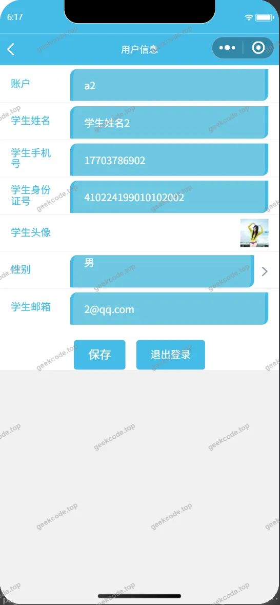</a><figcaption>小程序-个人信息userinfo</figcaption></figure>
<figure><a href="https://geekcode.top/archives/%E5%AE%BF%E8%88%8D%E7%AE%A1%E7%90%86%E7%B3%BB%E7%BB%9F%E5%B0%8F%E7%A8%8B%E5%BA%8F-%E8%AE%BA%E6%96%87pf?utm_source=github" title="查看完整源码">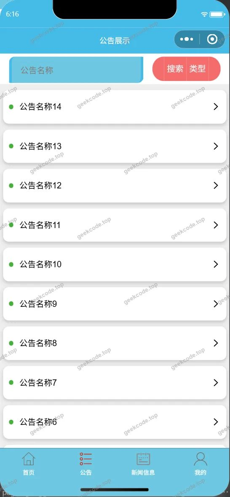</a><figcaption>小程序-公告</figcaption></figure>
<figure><a href="https://geekcode.top/archives/%E5%AE%BF%E8%88%8D%E7%AE%A1%E7%90%86%E7%B3%BB%E7%BB%9F%E5%B0%8F%E7%A8%8B%E5%BA%8F-%E8%AE%BA%E6%96%87pf?utm_source=github" title="查看完整源码">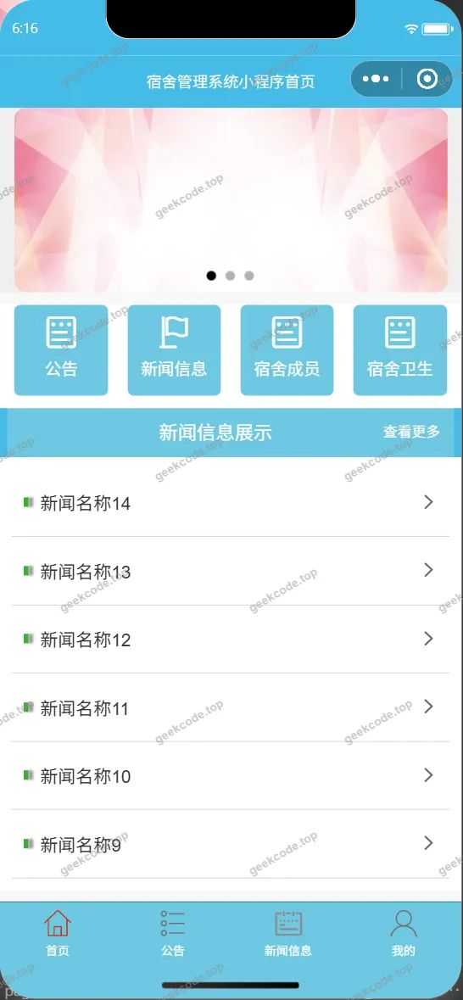</a><figcaption>小程序-首页</figcaption></figure>
<figure><figcaption>小程序-宿舍成员列表</figcaption></figure>
<figure><a href="https://geekcode.top/archives/%E5%AE%BF%E8%88%8D%E7%AE%A1%E7%90%86%E7%B3%BB%E7%BB%9F%E5%B0%8F%E7%A8%8B%E5%BA%8F-%E8%AE%BA%E6%96%87pf?utm_source=github" title="查看完整源码">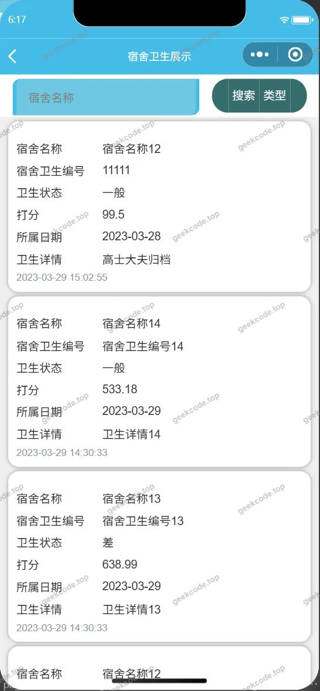</a><figcaption>小程序-宿舍卫生列表</figcaption></figure>
<figure><figcaption>小程序-忘记密码</figcaption></figure>
<figure><a href="https://geekcode.top/archives/%E5%AE%BF%E8%88%8D%E7%AE%A1%E7%90%86%E7%B3%BB%E7%BB%9F%E5%B0%8F%E7%A8%8B%E5%BA%8F-%E8%AE%BA%E6%96%87pf?utm_source=github" title="查看完整源码">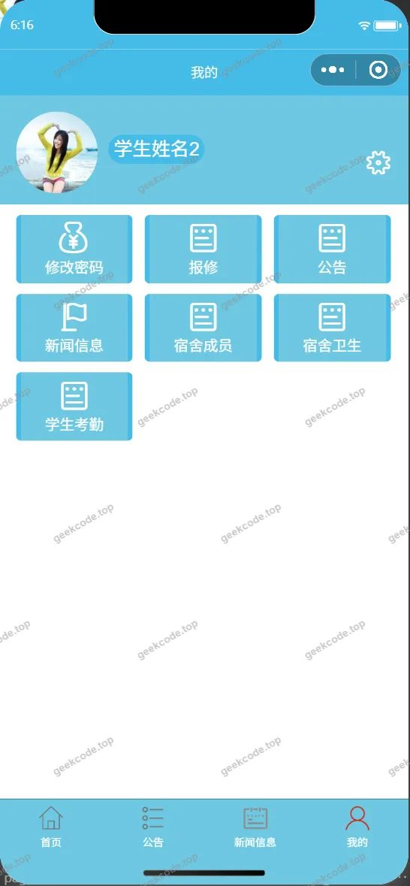</a><figcaption>小程序-我的</figcaption></figure>
<figure><a href="https://geekcode.top/archives/%E5%AE%BF%E8%88%8D%E7%AE%A1%E7%90%86%E7%B3%BB%E7%BB%9F%E5%B0%8F%E7%A8%8B%E5%BA%8F-%E8%AE%BA%E6%96%87pf?utm_source=github" title="查看完整源码">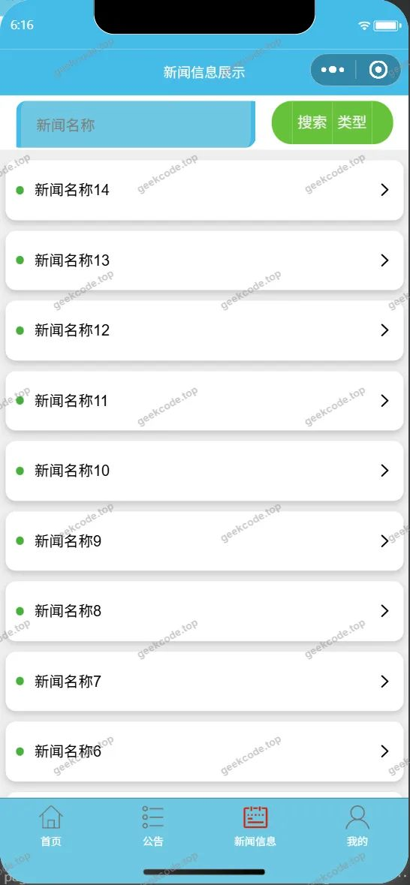</a><figcaption>小程序-新闻信息</figcaption></figure>
<figure><a href="https://geekcode.top/archives/%E5%AE%BF%E8%88%8D%E7%AE%A1%E7%90%86%E7%B3%BB%E7%BB%9F%E5%B0%8F%E7%A8%8B%E5%BA%8F-%E8%AE%BA%E6%96%87pf?utm_source=github" title="查看完整源码">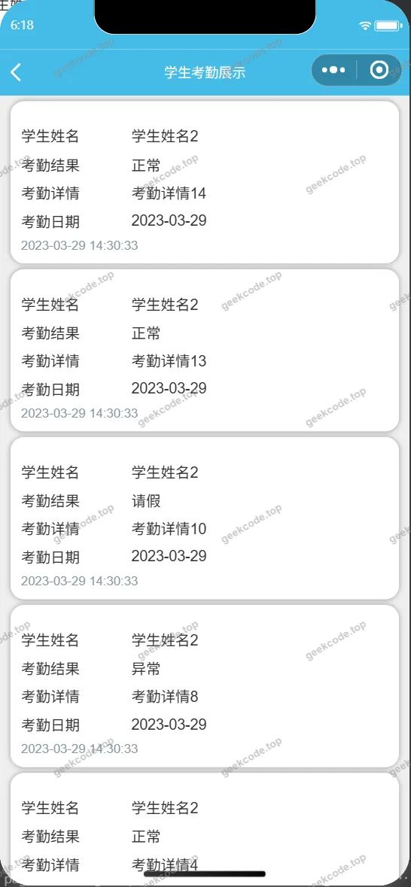</a><figcaption>小程序-学生考勤列表</figcaption></figure>
<figure><a href="https://geekcode.top/archives/%E5%AE%BF%E8%88%8D%E7%AE%A1%E7%90%86%E7%B3%BB%E7%BB%9F%E5%B0%8F%E7%A8%8B%E5%BA%8F-%E8%AE%BA%E6%96%87pf?utm_source=github" title="查看完整源码">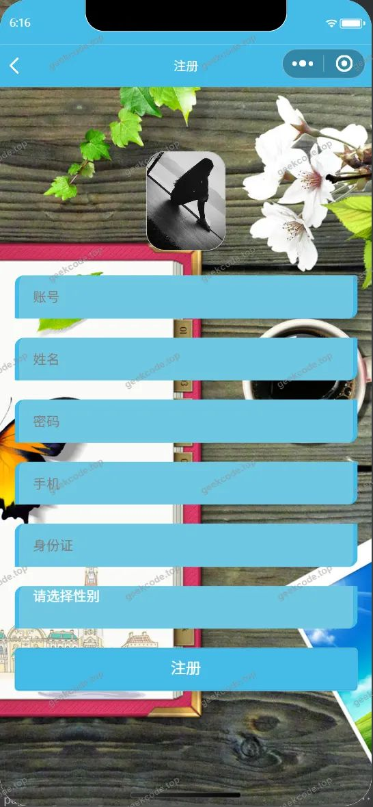</a><figcaption>小程序-注册</figcaption></figure>
<figure><a href="https://geekcode.top/archives/%E5%AE%BF%E8%88%8D%E7%AE%A1%E7%90%86%E7%B3%BB%E7%BB%9F%E5%B0%8F%E7%A8%8B%E5%BA%8F-%E8%AE%BA%E6%96%87pf?utm_source=github" title="查看完整源码">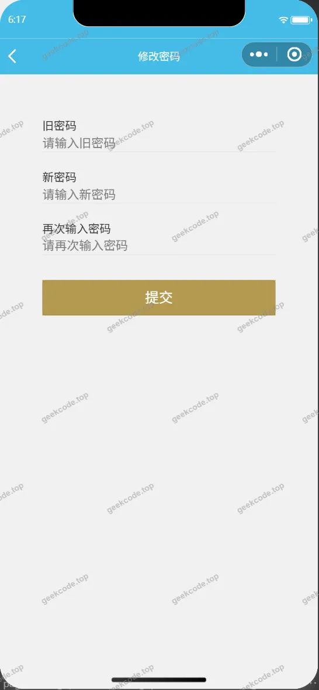</a><figcaption>小程序-changepassword</figcaption></figure>

<h3>后台管理端</h3>
<h4>后台-报修</h4>

<a href="https://geekcode.top/archives/%E5%AE%BF%E8%88%8D%E7%AE%A1%E7%90%86%E7%B3%BB%E7%BB%9F%E5%B0%8F%E7%A8%8B%E5%BA%8F-%E8%AE%BA%E6%96%87pf?utm_source=github" title="查看完整源码">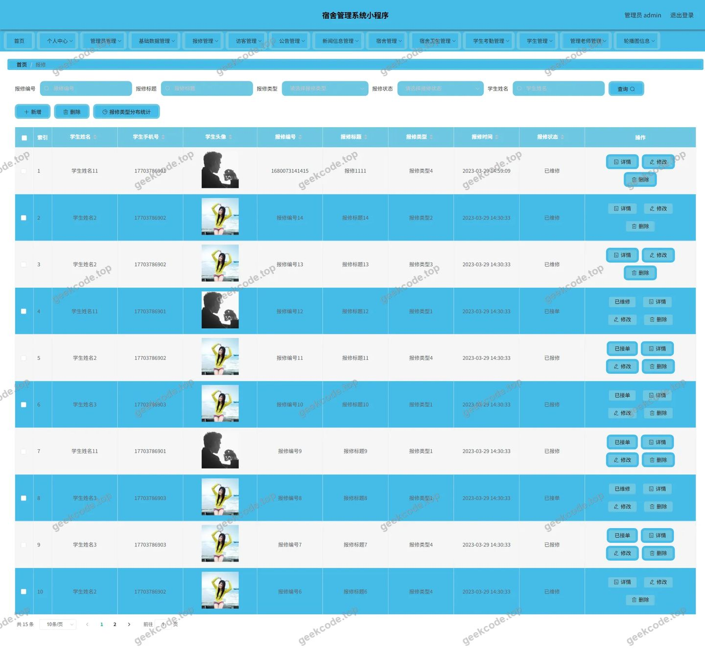</a>

<h4>后台-登录页</h4>

<a href="https://geekcode.top/archives/%E5%AE%BF%E8%88%8D%E7%AE%A1%E7%90%86%E7%B3%BB%E7%BB%9F%E5%B0%8F%E7%A8%8B%E5%BA%8F-%E8%AE%BA%E6%96%87pf?utm_source=github" title="查看完整源码">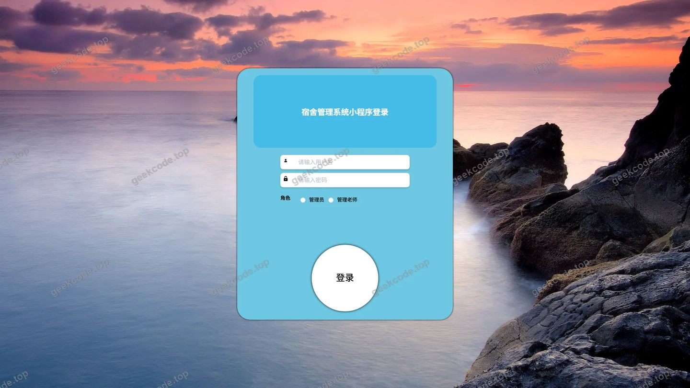</a>

<h4>后台-访客</h4>

<a href="https://geekcode.top/archives/%E5%AE%BF%E8%88%8D%E7%AE%A1%E7%90%86%E7%B3%BB%E7%BB%9F%E5%B0%8F%E7%A8%8B%E5%BA%8F-%E8%AE%BA%E6%96%87pf?utm_source=github" title="查看完整源码">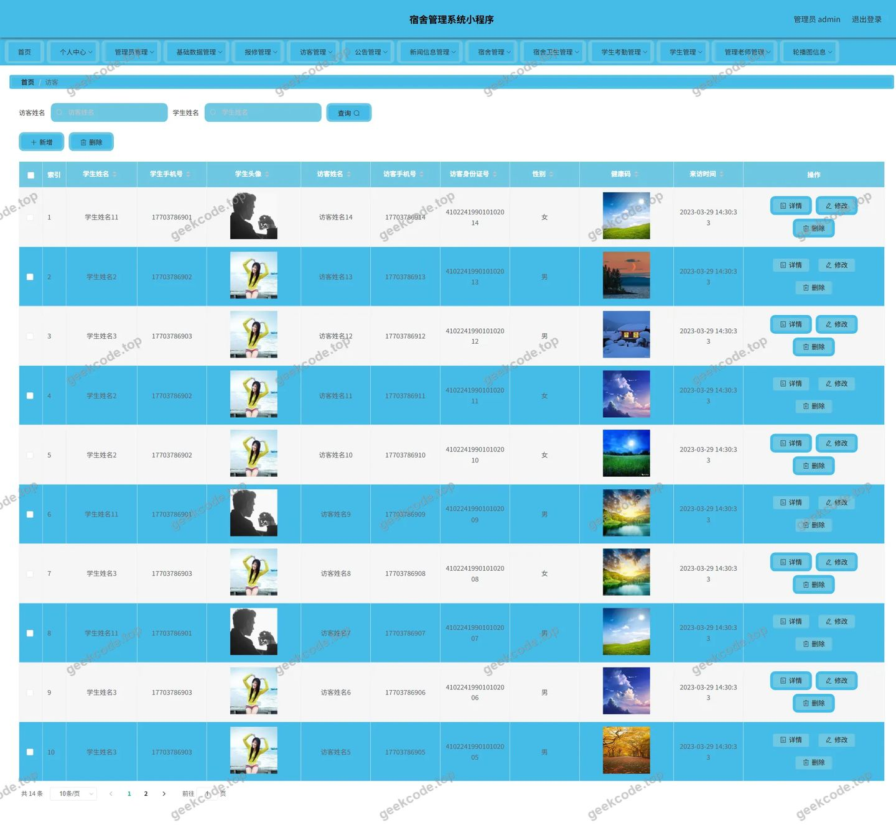</a>

<h4>后台-公告</h4>

<a href="https://geekcode.top/archives/%E5%AE%BF%E8%88%8D%E7%AE%A1%E7%90%86%E7%B3%BB%E7%BB%9F%E5%B0%8F%E7%A8%8B%E5%BA%8F-%E8%AE%BA%E6%96%87pf?utm_source=github" title="查看完整源码">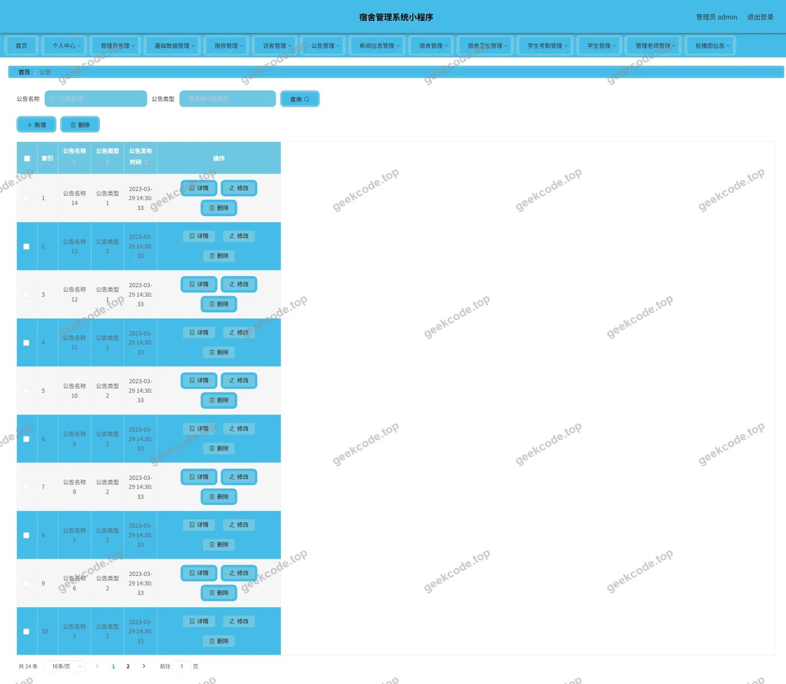</a>

<h4>后台-管理老师</h4>

<a href="https://geekcode.top/archives/%E5%AE%BF%E8%88%8D%E7%AE%A1%E7%90%86%E7%B3%BB%E7%BB%9F%E5%B0%8F%E7%A8%8B%E5%BA%8F-%E8%AE%BA%E6%96%87pf?utm_source=github" title="查看完整源码">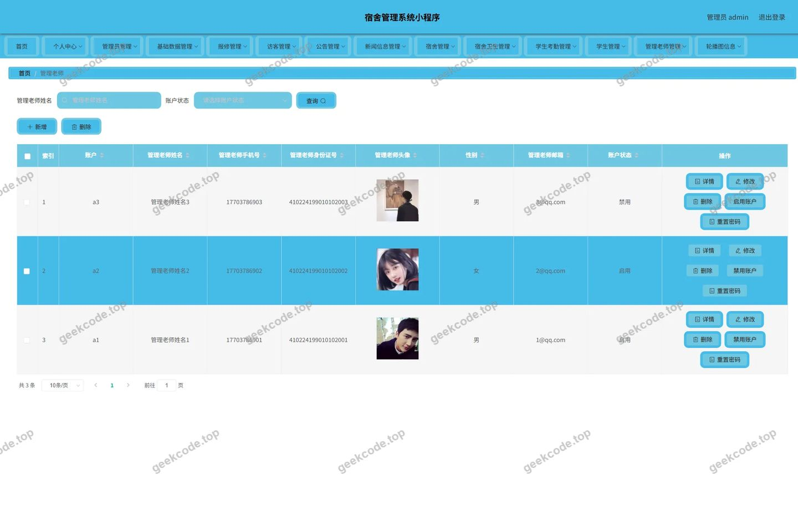</a>

<h4>后台-管理员</h4>

<a href="https://geekcode.top/archives/%E5%AE%BF%E8%88%8D%E7%AE%A1%E7%90%86%E7%B3%BB%E7%BB%9F%E5%B0%8F%E7%A8%8B%E5%BA%8F-%E8%AE%BA%E6%96%87pf?utm_source=github" title="查看完整源码">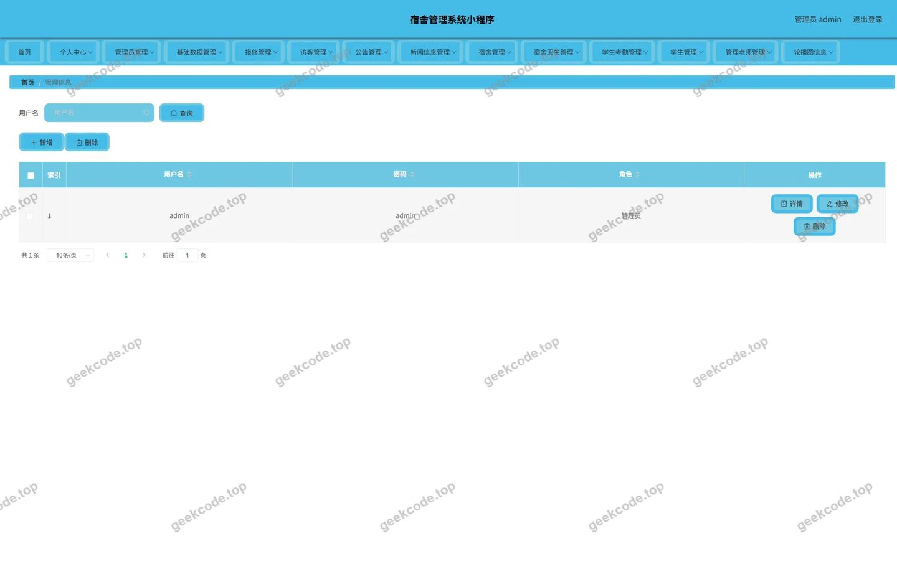</a>

<h4>后台-配置文件</h4>

<a href="https://geekcode.top/archives/%E5%AE%BF%E8%88%8D%E7%AE%A1%E7%90%86%E7%B3%BB%E7%BB%9F%E5%B0%8F%E7%A8%8B%E5%BA%8F-%E8%AE%BA%E6%96%87pf?utm_source=github" title="查看完整源码">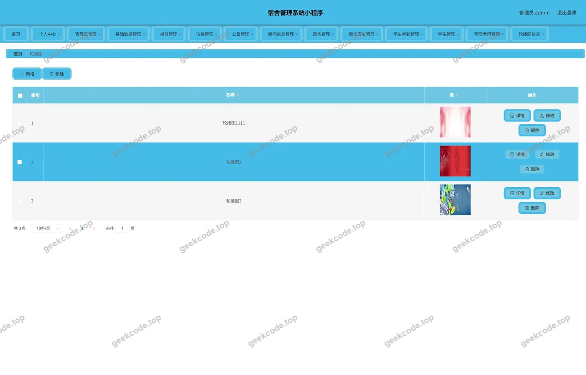</a>

<h4>后台首页</h4>

<a href="https://geekcode.top/archives/%E5%AE%BF%E8%88%8D%E7%AE%A1%E7%90%86%E7%B3%BB%E7%BB%9F%E5%B0%8F%E7%A8%8B%E5%BA%8F-%E8%AE%BA%E6%96%87pf?utm_source=github" title="查看完整源码">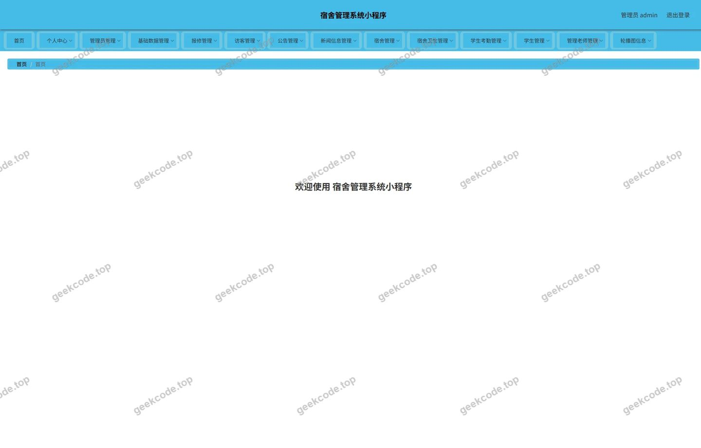</a>

---

## 获取完整源码

| 项目 | 说明 |
| --- | --- |
| 项目名 | 宿舍管理系统小程序--论文pf |
| 运行截图 | 本文 21 张（站点带水印原图，仓库 `images/` 目录） |
| 完整源码 | [https://geekcode.top/archives/%E5%AE%BF%E8%88%8D%E7%AE%A1%E7%90%86%E7%B3%BB%E7%BB%9F%E5%B0%8F%E7%A8%8B%E5%BA%8F-%E8%AE%BA%E6%96%87pf?utm_source=github](https://geekcode.top/archives/%E5%AE%BF%E8%88%8D%E7%AE%A1%E7%90%86%E7%B3%BB%E7%BB%9F%E5%B0%8F%E7%A8%8B%E5%BA%8F-%E8%AE%BA%E6%96%87pf?utm_source=github) |
| 咨询微信 | **ir9372**（备注：jingpin-yuanma） |
| 更多项目 | [极客代码 geekcode.top](https://geekcode.top/?utm_source=github) |

> 需要源码、部署、改配置、跑不起来等问题，加微信 ir9372 沟通，说明项目名即可。
